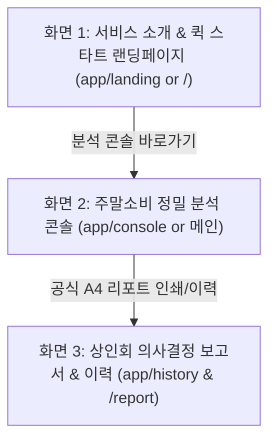

# 제주 구도심 주말소비 정밀 분석 포털 톤앤매너 및 디자인 전면 개편 계획서

본 문서는 루트 디렉터리의 [desgin.md](file:///c:/Users/jangd/OneDrive/바탕%20화면/jproject/desgin.md) (제주 주말소비 분석 포털 종합 기획 및 화면 상세 명세서 v1.0)에 정의된 브랜드 원칙, 컬러 시스템, 3대 핵심 화면 구조를 준수하여 사이트 전체의 톤앤매너와 UI/UX를 공공 행정 포털 수준으로 격상하기 위한 상세 개편 계획서입니다.

---

## 1. 개편 방향 및 브랜드 아이덴티티

- **브랜드 정체성**: (재)제주테크노파크(JTP) 빅데이터 센터 & 제주데이터허브 연계 공공 상권 분석 포털
- **핵심 브랜드 원칙 (Civic Reliability & Clarity)**:
  - 과장된 마케팅 요소를 배제하고, 신뢰성 높은 공공 행정 서식과 정갈한 시각적 위계 확립
  - 비회원/비로그인 방문자도 1초 만에 핵심 통계와 가치를 체감할 수 있는 퀵 체험 중심 설계
  - 소상공인 및 상인회가 지자체 심의·정기총회에 즉시 제출 가능한 표준 공문 규격 제공

---

## 2. 디자인 토큰 및 컬러 시스템 매핑

| 구분 | 색상명 | Hex Code | 기존 적용 | 개편 적용 위치 |
| :--- | :--- | :--- | :--- | :--- |
| **Primary** | Primary Blue | `#005BAC` | `#087f77` (청록) | 대표 브랜드 컬러, 메인 CTA 버튼, 활성 탭/링크 |
| **Primary Navy** | Brand Navy | `#0A1E3F` | `#14273a` (먹색) | 대헤드라인, 다크 히어로 배너, 최상위 텍스트 위계 |
| **토요일 (Sat)** | Teal-600 | `#0D9488` | `#11998e` | 토요일 통계 카드, 요일별 결제 건수 막대, 우세 뱃지 |
| **토요일 배경** | Teal-50 | `#F0FDFA` | `#f0f8f5` | 토요일 카드 배경 (`테두리: #CCFBF1`) |
| **일요일 (Sun)** | Blue-600 | `#2563EB` | `#4d7fca` | 일요일 통계 카드, 요일별 결제 건수 막대, 우세 뱃지 |
| **일요일 배경** | Blue-50 | `#EFF6FF` | `#eff4fb` | 일요일 카드 배경 (`테두리: #DBEAFE`) |
| **격차 우세** | Emerald-600 | `#059669` | `#168279` | 순차이(+288건, +2.18%) 및 우세 지표 강조 |
| **Surface BG** | Slate Surface | `#F8F9FA` | `#f4f6f5` | 전체 페이지 배경 및 중립 카드 표면 |

---

## 3. 핵심 3대 화면 개편 계획

### 📍 화면 1: 서비스 소개 및 퀵 스타트 랜딩페이지 (Landing & Quick Trial)
- **GNB 헤더 개편**:
  - `(재)제주테크노파크 빅데이터 센터` 로고 및 `제주데이터허브 제608호 관측 데이터` 공식 배지 적용
  - [데이터 분석 콘솔 바로가기] Primary Blue CTA 버튼 및 계정 메뉴
- **Hero Section**:
  - 좌측: 대헤드라인 *"데이터로 여는 제주 골목상권의 내일"*, [데이터 분석 콘솔 바로가기 (무료·비로그인)] 원클릭 버튼
  - 우측: `빠른 상권 비교 체험 위젯` (제주시/서귀포시 x 내국인/중국인 탭 클릭 시 즉시 수치 프리뷰 반영)
- **핵심 콘텐츠 섹션**:
  - 6대 공공 분석 원클릭 서비스 카드 (토·일 정밀 비교, 자연어 질의, 시계열 추이, 제608호 무결성, 안건 표준 서식, 공공 API 연동)
  - 상인회 3대 혁신 가치 (01. 수작업 엑셀 페어링 ZERO, 02. 수치 기반 안건 채택, 03. 맥락 기억 연속 대화)
  - 거버넌스 4단계 프로세스 & 상인회 FAQ 아코디언 & 하단 풀위드 배너

### 📍 화면 2: 주말소비 데이터 분석 콘솔 화면 (Analysis Console)
- **듀얼 입력 인터페이스 리파인**:
  - 자연어 상권 질의 엔진: 한국어 규칙 기반 파서 v2.4 탑재 + 실시간 추천 칩
  - 다차원 정밀 필터 탭: 제주시 구도심 / 서귀포시 구도심 세그먼트, 내국인 / 중국인 탭, 시작/종료월 드롭다운
- **정량 관측 결과 리포트 고도화**:
  - 핵심 의사결정 인사이트 박스: *"2017년 11월 제주시 구도심 내국인 결제는 토요일(13,502건)이 일요일(13,214건)보다 288건(+2.18%) 더 많았습니다."*
  - 점유율 및 누적 스펙트럼 (토 50.5% vs 일 49.5%) 게이지 바 추가
  - 토요일(Teal-600 `#0D9488`) vs 일요일(Blue-600 `#2563EB`) 카드 리디자인
- **1:1 요일 페어링 상세 장부 (Data Grid)**:
  - 월별 토요일/일요일 건수, 순차이량, 우세 판정 배지, 상인회 액션 가이드 컬럼 추가
- **GEMINI AI 상권 브리핑 연동**:
  - 공공 포털 톤에 맞춘 단정하고 신뢰도 높은 브리핑 카드 스타일 적용

### 📍 화면 3: 상인회 의사결정 보고서 및 이력 화면 (Official Report & History)
- **공식 회의용 A4 표준 리포트 출력 뷰 (`/report` 또는 `/history`)**:
  - 문서 관리번호 (`제주-JTP-2024-1108호`) 및 발급인증서관 직인 워터마크
  - 회의 안건 서식: `제주시 구도심 상권 주말(토·일) 영업일 인력 및 재고 배분 안건 의결의 건`
  - 상인회 공식 권고안 (토요일 피크타임 인력 15% 확충, 일요일 조기 마감 및 발주 조절)
  - 원클릭 A4 인쇄 / PDF 다운로드 서식
- **좌측 업무 이력 & 지원 패널**:
  - 소속 상인회 인증 카드 및 최근 질문 히스토리 필터

---

## 4. 단계별 실행 계획 (Action Items)

| 단계 | 작업 내용 | 수정 및 생성 대상 파일 |
| :---: | :--- | :--- |
| **1단계** | **글로벌 테마 및 디자인 토큰 셋업** | `app/globals.css`, `tailwind.config.mjs` (Primary `#005BAC`, Navy `#0A1E3F` 등) |
| **2단계** | **GNB 헤더 및 브랜드 로고 교체** | `components/weekend-dashboard.tsx`, `components/site-header.tsx` |
| **3단계** | **분석 콘솔(Console) 톤앤매너 리디자인** | `components/weekend-dashboard.tsx` (점유율 스펙트럼, 1:1 장부 표, 새 컬러 토큰 적용) |
| **4단계** | **서비스 소개 & 퀵 스타트 랜딩 섹션 구현** | `components/landing-hero.tsx` 또는 `weekend-dashboard.tsx` 탭/모드 전환 |
| **5단계** | **A4 공문서 규격 상인회 의결 리포트 구현** | `app/report/page.tsx` 또는 `components/official-report-modal.tsx` (인쇄 최적화) |
| **6단계** | **회귀 테스트 및 프로덕션 재배포** | `pnpm test`, `npx vercel --prod` |
